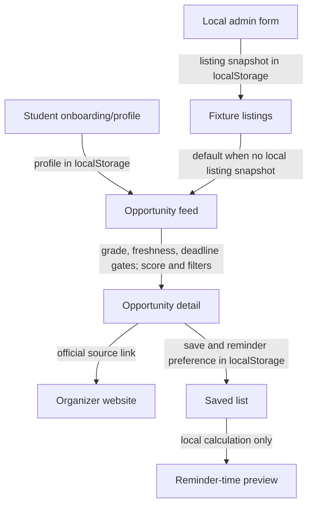

# Architecture

## Runtime shape

TalentaTrack is a client-interactive Next.js App Router application. `src/app/layout.tsx` wraps route content in `AppProvider` and `AppFrame`. Route components and shared components read and update a small local application state; no API server or external data service is connected.

## Main areas

- `src/app/`: route entry points for onboarding, feed, opportunity detail, saved list, profile, and local admin.
- `src/components/app-frame.tsx`: navigation shell and route context.
- `src/components/providers.tsx`: browser state provider. It reads/writes JSON snapshots in `localStorage`, uses fixture opportunities when no local listing snapshot exists, and emits same-tab storage-change events.
- `src/components/opportunity-form.tsx`: local curator create/edit and publish form.
- `src/components/opportunity-card.tsx` and `opportunity-detail.tsx`: feed and listing presentation.
- `src/lib/types.ts`: TypeScript domain contracts.
- `src/lib/fixtures.ts`: bundled opportunity records and UI option labels.
- `src/lib/matching.ts`: eligibility, verification freshness, visibility, scoring, and ordering.
- `src/lib/deadlines.ts`: exact timestamp conversion, Indonesian timezone handling, formatting, and deadline checks.
- `src/lib/reminders.ts`: reminder-time preview calculation only.
- `tests/`: Vitest unit tests for matching, deadlines, and reminder calculations.

## Core user data flow

The organizer website is opened as an external link. The application does not fetch listings from that source or automatically validate it.

## Matching and visibility

The feed uses `src/lib/matching.ts`. A listing must be published, have verification no older than 30 days, include the student's grade, and have a future exact instant when its deadline is fixed. Eligible listings receive a deterministic score from selected-interest overlap, location, and participation preference. Tie-breaking uses exact deadline instant, then title. No ML model or behavior-based personalization is present.

## Persistence and external services

The provider uses these browser keys:

- `talentatrack:profile`
- `talentatrack:saved`
- `talentatrack:opportunities`

With no stored listing snapshot, the app uses `FIXTURE_OPPORTUNITIES`. Updates are local to the browser/origin and can be cleared by browser storage controls or the admin demo reset. There is no Supabase client, API persistence, authentication provider, email provider, scheduler, analytics integration, or deployment integration in the inspected source/configuration.

Reminder previews are computed from the deadline's local calendar date and the student's selected timezone. The UI labels them as previews; no delivery side effect occurs.
